# Arka.fund Final Platform Manual

Date: 2026-05-21

Status: Final T25 platform manual for the current dApp before testnet dress rehearsal and final mainnet cutover.

This manual is generated from `./platform-manual-screen-manifest.json` and `./figma-route-audit-manifest.json`. Screenshots are the same route captures used by the visual audit, so the document is tied to rendered product state rather than hand-written claims.

## Completion State

- Global status after T25: **98.74% implemented / 1.26% remaining**.
- Completed canonical items after T25: **25 / 27**.
- Remaining canonical items: T26 Testnet Dress Rehearsal, T27 Final Mainnet Cutover.
- Captured screens: **29**.
- Public/read captures: **20**.
- Verified-operator captures: **9**.

## Mainnet Blockers

### T26 testnet dress rehearsal is not yet complete

The full create/deposit/route/rebalance/coverage/governance/operator path still needs final production-like testnet evidence and transaction hashes.

Evidence: [docs/REMAINING_SINGLE_ITERATION_PLAN_2026-05-18.md](./REMAINING_SINGLE_ITERATION_PLAN_2026-05-18.md)

### T27 final mainnet cutover is intentionally pending

The repository must not claim 100% mainnet launch completion until canonical mainnet deployment, Vercel production env and post-deploy canary evidence are recorded.

Evidence: [docs/REMAINING_SINGLE_ITERATION_PLAN_2026-05-18.md](./REMAINING_SINGLE_ITERATION_PLAN_2026-05-18.md)

### Production dependency audit has expiring SODAX transitive exceptions

The production audit gate has zero unapproved high/critical blockers, but the current SODAX transitive exception policy remains explicitly documented and expiring.

Evidence: [config/production-audit-policy.json](../config/production-audit-policy.json)

## Claim Traceability

Every platform/security/protocol claim below links to implementation and test evidence. Mainnet-only claims remain blockers until T26/T27 evidence exists.

### 1. product-operator-route-boundary

Public product routes are separated from verified operator console routes.

Implementation:
- [src/lib/workflows/productNavigation.ts](../src/lib/workflows/productNavigation.ts)
- [src/components/product/AppChrome.tsx](../src/components/product/AppChrome.tsx)

Tests:
- [tests/unit/product-navigation.test.ts](../tests/unit/product-navigation.test.ts)
- [tests/integration/app-chrome.test.tsx](../tests/integration/app-chrome.test.tsx)
- [e2e/access-state.spec.ts](../e2e/access-state.spec.ts)

### 2. dao-governed-write-boundary

DAO-governed mutations are classified and routed through governance policy instead of being silently exposed as arbitrary writes.

Implementation:
- [src/lib/workflows/daoExecutionPolicy.ts](../src/lib/workflows/daoExecutionPolicy.ts)
- [src/lib/workflows/governanceComposer.ts](../src/lib/workflows/governanceComposer.ts)
- [src/app/governance/console/page.tsx](../src/app/governance/console/page.tsx)

Tests:
- [tests/unit/dao-execution-policy.test.ts](../tests/unit/dao-execution-policy.test.ts)
- [tests/unit/governance-composer.test.ts](../tests/unit/governance-composer.test.ts)
- [tests/integration/contracts-page.test.tsx](../tests/integration/contracts-page.test.tsx)

### 3. smart-routing-source-of-truth

Smart Routing uses the broker-scale planner, benchmark gate and canary gate instead of static UI route claims.

Implementation:
- [src/lib/workflows/rebalanceRouting.ts](../src/lib/workflows/rebalanceRouting.ts)
- [src/lib/workflows/rebalanceBenchmark.ts](../src/lib/workflows/rebalanceBenchmark.ts)
- [src/lib/runtime/rebalanceBenchmarkGate.ts](../src/lib/runtime/rebalanceBenchmarkGate.ts)
- [src/lib/runtime/rebalanceCanaryGate.ts](../src/lib/runtime/rebalanceCanaryGate.ts)

Tests:
- [tests/unit/rebalance-routing.test.ts](../tests/unit/rebalance-routing.test.ts)
- [tests/unit/rebalance-benchmark.test.ts](../tests/unit/rebalance-benchmark.test.ts)
- [tests/unit/rebalance-benchmark-gate.test.ts](../tests/unit/rebalance-benchmark-gate.test.ts)
- [tests/unit/rebalance-canary-gate.test.ts](../tests/unit/rebalance-canary-gate.test.ts)
- [tests/integration/api-rebalance-benchmark-route.test.ts](../tests/integration/api-rebalance-benchmark-route.test.ts)

### 4. balanced-sodax-auto-boundary

Balanced/SODAX AUTO is documented as intent-surface evidence and not as a fabricated public router contract.

Implementation:
- [src/lib/workflows/balancedOfficialSurfaceEvidence.ts](../src/lib/workflows/balancedOfficialSurfaceEvidence.ts)
- [src/lib/runtime/balancedAutoSurfaceGate.ts](../src/lib/runtime/balancedAutoSurfaceGate.ts)
- [src/app/api/intents/balanced/evidence/route.ts](../src/app/api/intents/balanced/evidence/route.ts)

Tests:
- [tests/unit/balanced-official-surface-evidence.test.ts](../tests/unit/balanced-official-surface-evidence.test.ts)
- [tests/unit/balanced-auto-surface-gate.test.ts](../tests/unit/balanced-auto-surface-gate.test.ts)
- [tests/integration/api-balanced-evidence-route.test.ts](../tests/integration/api-balanced-evidence-route.test.ts)
- [e2e/balanced-intent-surface.spec.ts](../e2e/balanced-intent-surface.spec.ts)

### 5. storage-lifecycle-hardening

Soroban storage lifecycle and extension operations are documented as an operator runbook and script path.

Implementation:
- [src/lib/contracts/storageLifecycle.ts](../src/lib/contracts/storageLifecycle.ts)
- [scripts/contracts_storage_extend.mjs](../scripts/contracts_storage_extend.mjs)
- [docs/STORAGE_LIFECYCLE_RUNBOOK_2026-05-20.md](./STORAGE_LIFECYCLE_RUNBOOK_2026-05-20.md)

Tests:
- [tests/unit/contracts-storage-lifecycle.test.ts](../tests/unit/contracts-storage-lifecycle.test.ts)
- [tests/integration/contracts-storage-extend-script.test.ts](../tests/integration/contracts-storage-extend-script.test.ts)
- [tests/integration/api-contracts-storage-lifecycle-route.test.ts](../tests/integration/api-contracts-storage-lifecycle-route.test.ts)

### 6. production-release-gate

Production deployment is blocked by a machine-consumable release gate until environment, oracle, routing, API, visual and audit posture are ready.

Implementation:
- [src/lib/runtime/productionEnvironmentGate.ts](../src/lib/runtime/productionEnvironmentGate.ts)
- [src/app/api/release/gate/route.ts](../src/app/api/release/gate/route.ts)
- [vercel.json](../vercel.json)
- [scripts/production_dependency_audit.mjs](../scripts/production_dependency_audit.mjs)

Tests:
- [tests/unit/production-environment-gate.test.ts](../tests/unit/production-environment-gate.test.ts)
- [tests/integration/api-release-gate-route.test.ts](../tests/integration/api-release-gate-route.test.ts)
- [e2e/release-gate.spec.ts](../e2e/release-gate.spec.ts)

### 7. visual-screenshot-contract

The manual screenshots are generated from the same Playwright route manifest used by the design audit.

Implementation:
- [docs/figma-route-audit-manifest.json](./figma-route-audit-manifest.json)
- [e2e/design-audit.spec.ts](../e2e/design-audit.spec.ts)
- [scripts/generate_platform_manual.mjs](../scripts/generate_platform_manual.mjs)

Tests:
- [tests/unit/figma-route-audit-manifest.test.ts](../tests/unit/figma-route-audit-manifest.test.ts)
- [tests/unit/platform-manual-manifest.test.ts](../tests/unit/platform-manual-manifest.test.ts)
- [tests/integration/platform-manual-generator.test.ts](../tests/integration/platform-manual-generator.test.ts)

## Screen Manual With Current Screenshots

### 1. Dashboard shell

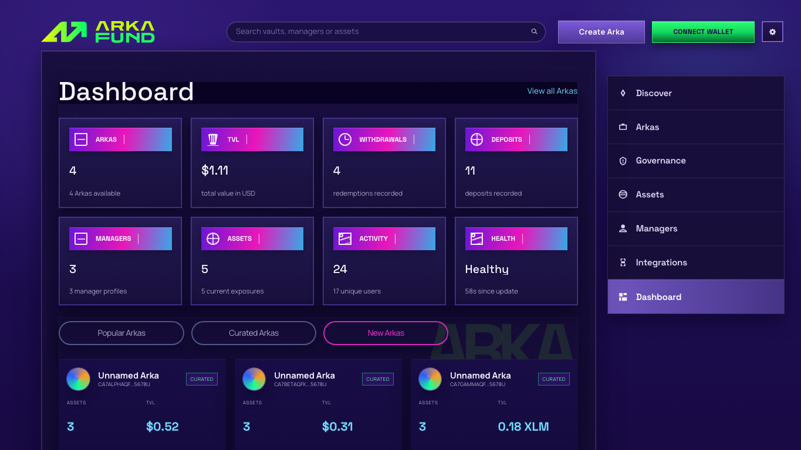

- Route: `/dashboard`
- Access: `public/read`
- Classification: public product
- Audience: Depositors, managers and operators reviewing the global product posture.
- Visual source: Figma/reference family: `public-dashboard`, reference `vaults screens(4).png`.

Purpose:

Summarize indexed Arkas, manager posture, NAV history and public operating health from catalog-backed data.

Reads:
- dashboard catalog summary
- ranked Arkas
- ranked managers
- NAV/activity snapshots

Actions:
- change dashboard tabs and ranges
- open product routes
- open Create Arka

Boundary:

No wallet write is performed on this screen; unavailable history is shown explicitly instead of fabricated charts.

Implementation:
- [src/components/product/DashboardSurface.tsx](../src/components/product/DashboardSurface.tsx)
- [src/lib/catalog/dashboardDiscoverSurfaces.ts](../src/lib/catalog/dashboardDiscoverSurfaces.ts)

Tests:
- [tests/integration/dashboard-surface.test.tsx](../tests/integration/dashboard-surface.test.tsx)
- [e2e/product-surfaces.spec.ts](../e2e/product-surfaces.spec.ts)

### 2. Discover landing

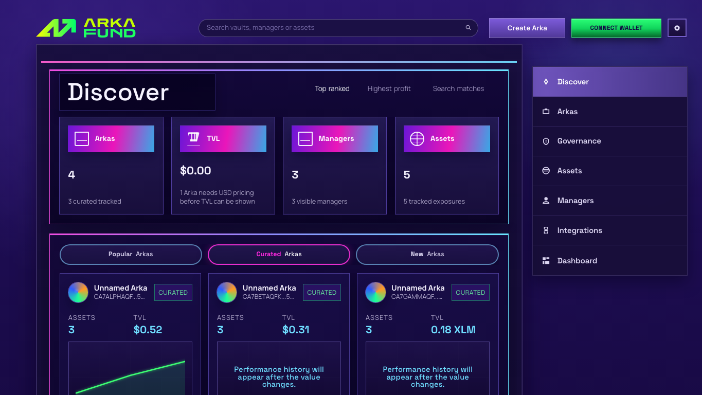

- Route: `/discover`
- Access: `public/read`
- Classification: public product
- Audience: Users searching the indexed Arka, manager and asset universe.
- Visual source: Figma/reference family: `public-dashboard`, reference `vaults screens(4).png`.

Purpose:

Search and filter the catalog before opening product profiles or execution routes.

Reads:
- catalog Arkas
- catalog managers
- catalog assets
- leaderboard source telemetry

Actions:
- search
- toggle curated/window filters
- open leaderboard/profile routes
- open Create Arka

Boundary:

Discovery is read-only and does not sign transactions.

Implementation:
- [src/components/product/DiscoverSurface.tsx](../src/components/product/DiscoverSurface.tsx)
- [src/lib/catalog/dashboardDiscoverSurfaces.ts](../src/lib/catalog/dashboardDiscoverSurfaces.ts)

Tests:
- [tests/integration/discover-surface.test.tsx](../tests/integration/discover-surface.test.tsx)
- [e2e/product-surfaces.spec.ts](../e2e/product-surfaces.spec.ts)

### 3. Create wizard

- Route: `/factory/create`
- Access: `public/read`
- Classification: public deployment flow
- Audience: Users creating a new Arka through the guided wizard.
- Visual source: Figma/reference family: `create-wizard`, reference `vaults screens(13).png`.

Purpose:

Entry frame for the Figma-aligned Create Arka wizard before parameters are selected.

Reads:
- asset registry
- runtime factory config
- wizard state

Actions:
- start guided creation
- select next wizard step

Boundary:

No protocol strategy is configured during creation; execution actions happen after an Arka exists.

Implementation:
- [src/app/factory/create/CreateArkaClient.tsx](../src/app/factory/create/CreateArkaClient.tsx)
- [src/lib/workflows/createWizardState.ts](../src/lib/workflows/createWizardState.ts)

Tests:
- [tests/unit/create-wizard-state.test.ts](../tests/unit/create-wizard-state.test.ts)
- [e2e/create-wizard-matrix.spec.ts](../e2e/create-wizard-matrix.spec.ts)

### 4. Create wizard - basics step

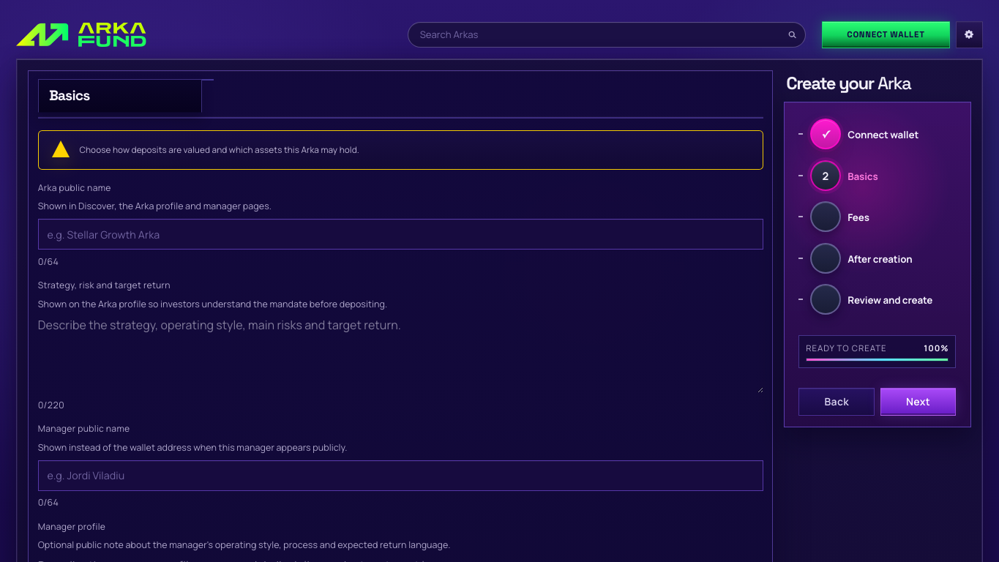

- Route: `/factory/create?step=basics`
- Access: `public/read`
- Classification: public deployment flow
- Audience: Arka creator.
- Visual source: Figma/reference family: `create-wizard`, reference `vaults screens(13).png`.

Purpose:

Collect the basic name, manager and denomination setup for a new Arka.

Reads:
- core Stellar asset registry
- wallet identity
- factory defaults

Actions:
- choose denomination
- enter manager/basic fields
- validate fields

Boundary:

Field validation happens before build/submit; no invented asset IDs are injected.

Implementation:
- [src/app/factory/create/CreateArkaClient.tsx](../src/app/factory/create/CreateArkaClient.tsx)
- [src/lib/workflows/assetSelection.ts](../src/lib/workflows/assetSelection.ts)

Tests:
- [tests/unit/asset-selection.test.ts](../tests/unit/asset-selection.test.ts)
- [e2e/create-wizard-matrix.spec.ts](../e2e/create-wizard-matrix.spec.ts)

### 5. Create wizard - fees step

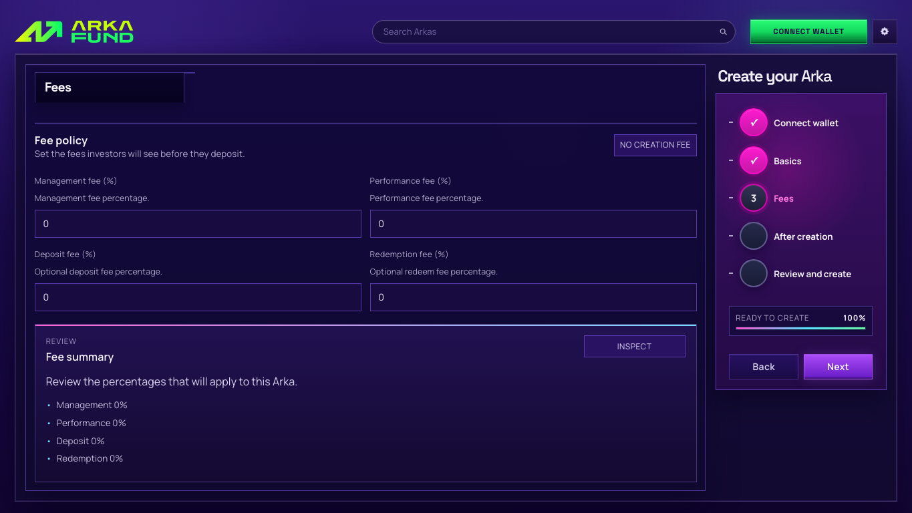

- Route: `/factory/create?step=fees`
- Access: `public/read`
- Classification: public deployment flow
- Audience: Arka creator.
- Visual source: Figma/reference family: `create-wizard`, reference `vaults screens(13).png`.

Purpose:

Configure management/performance fee posture with reviewable numeric inputs.

Reads:
- wizard fee state
- factory constraints

Actions:
- set fee values
- move to deposits step

Boundary:

Fee values are typed and validated before transaction payload construction.

Implementation:
- [src/app/factory/create/CreateArkaClient.tsx](../src/app/factory/create/CreateArkaClient.tsx)
- [src/lib/workflows/createWizardState.ts](../src/lib/workflows/createWizardState.ts)

Tests:
- [tests/unit/create-wizard-state.test.ts](../tests/unit/create-wizard-state.test.ts)
- [tests/integration/workflow-surfaces.test.tsx](../tests/integration/workflow-surfaces.test.tsx)

### 6. Create wizard - deposits step

- Route: `/factory/create?step=deposits`
- Access: `public/read`
- Classification: public deployment flow
- Audience: Arka creator.
- Visual source: Figma/reference family: `create-wizard`, reference `vaults screens(13).png`.

Purpose:

Configure deposit policy, permitted wallet posture and deposit limits.

Reads:
- wizard deposit state
- policy defaults

Actions:
- enable/disable deposit restrictions
- set minimum/maximum policy fields

Boundary:

Deposit policy is surfaced as creation policy, not as a post-hoc fake badge.

Implementation:
- [src/app/factory/create/CreateArkaClient.tsx](../src/app/factory/create/CreateArkaClient.tsx)
- [src/lib/workflows/createWizardState.ts](../src/lib/workflows/createWizardState.ts)

Tests:
- [tests/unit/create-wizard-state.test.ts](../tests/unit/create-wizard-state.test.ts)
- [e2e/create-wizard-matrix.spec.ts](../e2e/create-wizard-matrix.spec.ts)

### 7. Create wizard - redemptions step

- Route: `/factory/create?step=redemptions`
- Access: `public/read`
- Classification: public deployment flow
- Audience: Arka creator.
- Visual source: Figma/reference family: `create-wizard`, reference `vaults screens(13).png`.

Purpose:

Configure redemption policy before final review.

Reads:
- wizard redemption state
- policy defaults

Actions:
- set redemption posture
- continue to asset management

Boundary:

Redemption policy remains part of the deployment payload review path.

Implementation:
- [src/app/factory/create/CreateArkaClient.tsx](../src/app/factory/create/CreateArkaClient.tsx)
- [src/lib/workflows/createWizardState.ts](../src/lib/workflows/createWizardState.ts)

Tests:
- [tests/unit/create-wizard-state.test.ts](../tests/unit/create-wizard-state.test.ts)
- [e2e/create-wizard-matrix.spec.ts](../e2e/create-wizard-matrix.spec.ts)

### 8. Create wizard - assets management step

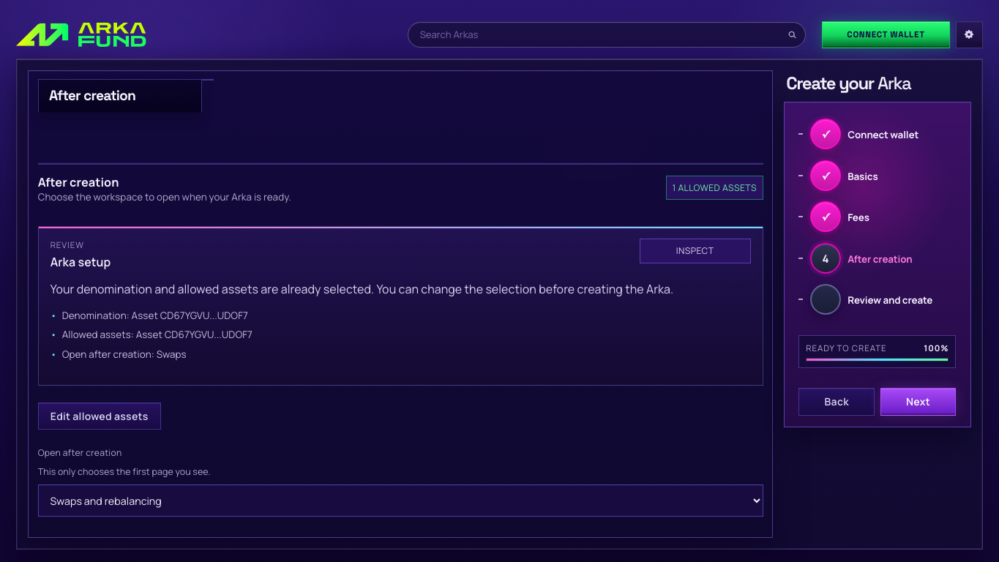

- Route: `/factory/create?step=assets`
- Access: `public/read`
- Classification: public deployment flow
- Audience: Arka creator.
- Visual source: Figma/reference family: `create-wizard`, reference `vaults screens(13).png`.

Purpose:

Select initial supported assets from the real registry with icons/metadata where available.

Reads:
- core Stellar asset registry
- stellar.toml-derived metadata
- wizard asset state

Actions:
- search assets
- select assets
- review selected set

Boundary:

Known assets are selected from registry data; unsupported assets are not presented as configured.

Implementation:
- [src/lib/catalog/coreStellarAssetRegistry.ts](../src/lib/catalog/coreStellarAssetRegistry.ts)
- [src/lib/server/stellarToml.ts](../src/lib/server/stellarToml.ts)
- [src/app/factory/create/CreateArkaClient.tsx](../src/app/factory/create/CreateArkaClient.tsx)

Tests:
- [tests/unit/core-stellar-asset-registry.test.ts](../tests/unit/core-stellar-asset-registry.test.ts)
- [tests/unit/asset-selection.test.ts](../tests/unit/asset-selection.test.ts)
- [e2e/create-wizard-matrix.spec.ts](../e2e/create-wizard-matrix.spec.ts)

### 9. Create wizard - review step

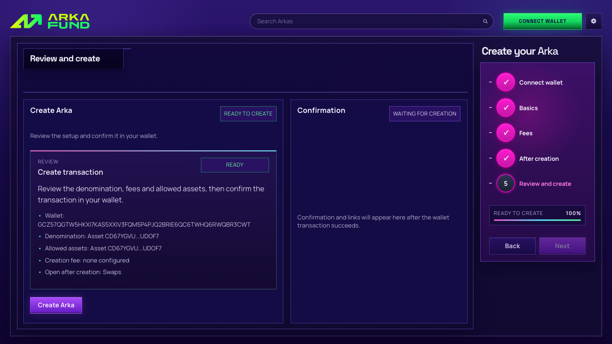

- Route: `/factory/create?step=review`
- Access: `public/read`
- Classification: public deployment flow
- Audience: Arka creator.
- Visual source: Figma/reference family: `create-wizard`, reference `vaults screens(13).png`.

Purpose:

Review the complete creation payload before wallet signing.

Reads:
- wizard state
- factory build route
- wallet state

Actions:
- build payload
- submit create transaction when wallet permits

Boundary:

Review is explicit; the UI does not silently instantiate without payload visibility.

Implementation:
- [src/app/api/factory/create/build/route.ts](../src/app/api/factory/create/build/route.ts)
- [src/app/factory/create/CreateArkaClient.tsx](../src/app/factory/create/CreateArkaClient.tsx)

Tests:
- [tests/integration/workflow-surfaces.test.tsx](../tests/integration/workflow-surfaces.test.tsx)
- [e2e/create-wizard-matrix.spec.ts](../e2e/create-wizard-matrix.spec.ts)

### 10. Arkas leaderboard

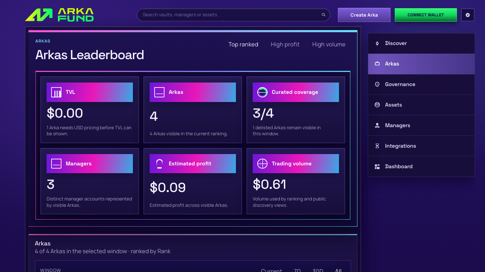

- Route: `/vaults`
- Access: `public/read`
- Classification: public product
- Audience: Users comparing Arkas before selecting one.
- Visual source: Figma/reference family: `arkas-leaderboard`, reference `vaults screens(5).png`.

Purpose:

Rank and filter Arkas by truthful catalog-backed metrics.

Reads:
- Arka leaderboard API
- leaderboard source
- catalog-derived metrics

Actions:
- search
- sort
- page
- open product profile
- open live ops

Boundary:

This is review mode; deposits/rebalances live under /arkas/[id].

Implementation:
- [src/components/product/VaultLeaderboardSurface.tsx](../src/components/product/VaultLeaderboardSurface.tsx)
- [src/lib/catalog/vaults.ts](../src/lib/catalog/vaults.ts)

Tests:
- [tests/integration/vault-entrypoints.test.tsx](../tests/integration/vault-entrypoints.test.tsx)
- [e2e/vault-entrypoints.spec.ts](../e2e/vault-entrypoints.spec.ts)

### 11. Assets surface

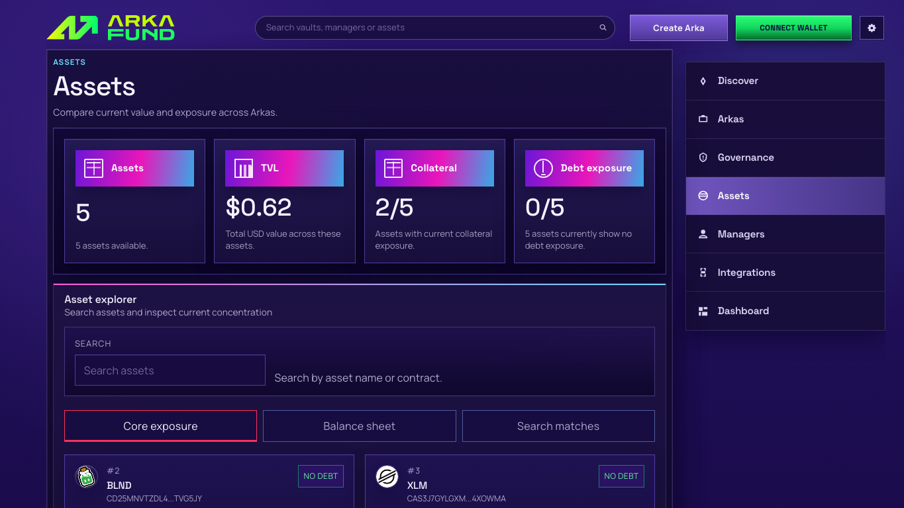

- Route: `/assets`
- Access: `public/read`
- Classification: public product
- Audience: Users reviewing concentration and asset availability.
- Visual source: Figma/reference family: `assets-table`, reference `vaults screens(9).png`.

Purpose:

Expose core Stellar assets and catalog-linked exposure without requiring raw contract IDs.

Reads:
- core Stellar asset registry
- asset catalog
- asset metadata/icons

Actions:
- search assets
- open asset detail

Boundary:

Asset icons/metadata come from registry or stellar.toml/CDN fallbacks, not invented UI constants.

Implementation:
- [src/components/product/AssetsSurface.tsx](../src/components/product/AssetsSurface.tsx)
- [src/lib/catalog/coreStellarAssetRegistry.ts](../src/lib/catalog/coreStellarAssetRegistry.ts)

Tests:
- [tests/unit/core-stellar-asset-registry.test.ts](../tests/unit/core-stellar-asset-registry.test.ts)
- [tests/integration/manager-asset-surfaces.test.tsx](../tests/integration/manager-asset-surfaces.test.tsx)

### 12. Vault profile

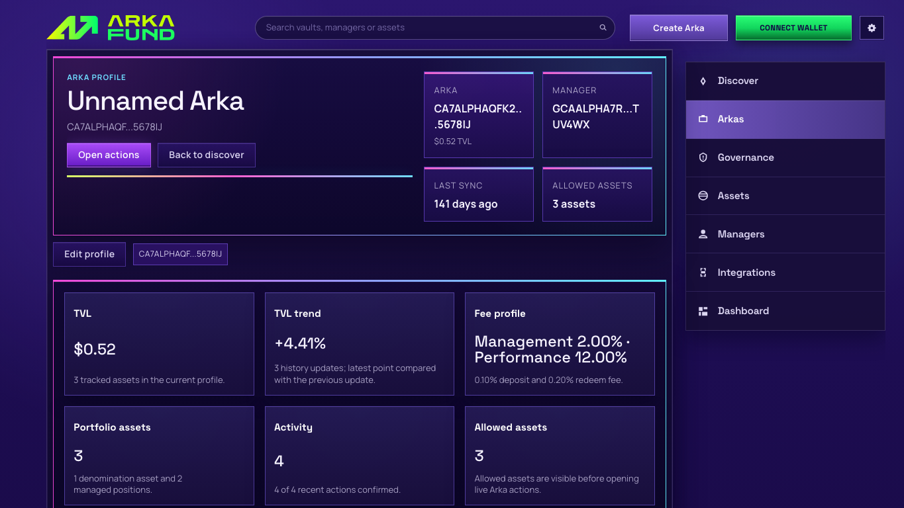

- Route: `/vaults/CA7ALPHAQFK2MZKJY4R5S8N2P1T6V9W3X7Y2Z5ABCD1EFGH2345678IJ`
- Access: `public/read`
- Classification: public product
- Audience: Users inspecting one Arka before live execution.
- Visual source: Figma/reference family: `vault-detail`, reference `vaults screens(6).png`.

Purpose:

Show the indexed product profile, manager, allocation and route posture.

Reads:
- vault detail catalog
- linked asset/manager context

Actions:
- open live execution
- return to leaderboard

Boundary:

Profile mode is separate from live wallet-backed execution.

Implementation:
- [src/components/product/VaultDetailSurface.tsx](../src/components/product/VaultDetailSurface.tsx)
- [src/app/vaults/[id]/page.tsx](../src/app/vaults/[id]/page.tsx)

Tests:
- [tests/integration/vault-detail-surface.test.tsx](../tests/integration/vault-detail-surface.test.tsx)
- [e2e/vault-profile.spec.ts](../e2e/vault-profile.spec.ts)

### 13. Integrations product/operator surface

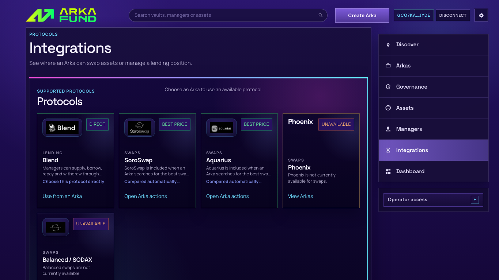

- Route: `/integrations`
- Access: `verified operator`
- Classification: public protocol overview
- Audience: Users and operators reviewing supported protocol posture.
- Visual source: Figma/reference family: `integrations`, reference `vaults screens(10).png`.

Purpose:

Explain Aquarius, SoroSwap, Balanced/SODAX and Blend support status with runtime-backed evidence.

Reads:
- protocol support
- Balanced/SODAX evidence
- adapter config

Actions:
- inspect quote/status surfaces
- open operator lane when verified

Boundary:

Balanced/SODAX is shown as intent integration evidence, not as a fake router contract.

Implementation:
- [src/app/integrations/page.tsx](../src/app/integrations/page.tsx)
- [src/lib/workflows/integrationWorkspaces.ts](../src/lib/workflows/integrationWorkspaces.ts)
- [src/lib/workflows/balancedOfficialSurfaceEvidence.ts](../src/lib/workflows/balancedOfficialSurfaceEvidence.ts)

Tests:
- [tests/integration/live-ops-surfaces.test.tsx](../tests/integration/live-ops-surfaces.test.tsx)
- [e2e/balanced-intent-surface.spec.ts](../e2e/balanced-intent-surface.spec.ts)

### 14. Managers leaderboard

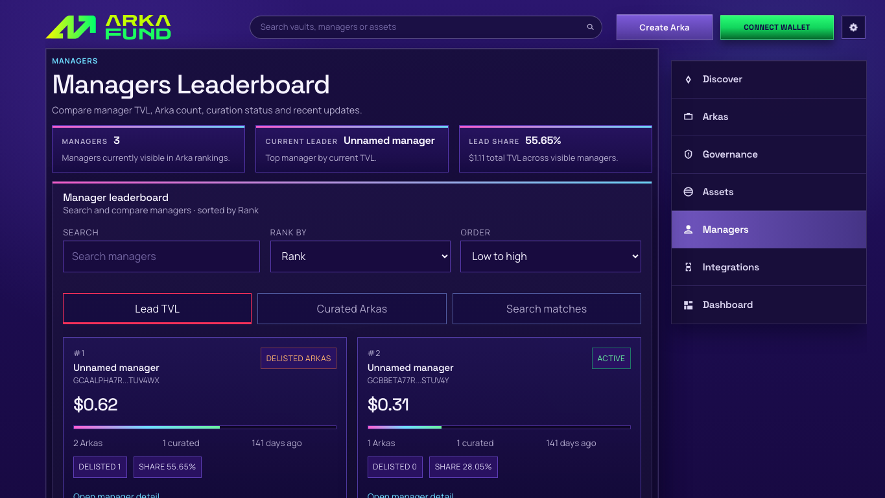

- Route: `/managers`
- Access: `public/read`
- Classification: public product
- Audience: Users comparing manager mandate and reputation context.
- Visual source: Figma/reference family: `derived-leaderboard`, reference `vaults screens(14).png`.

Purpose:

Rank managers using catalog-backed NAV, curated mandate and search signals.

Reads:
- manager leaderboard API
- leaderboard source
- catalog manager profiles

Actions:
- search
- sort
- open manager detail

Boundary:

Manager reputation is read here; governed mutations are not performed from this public list.

Implementation:
- [src/components/product/ManagersSurface.tsx](../src/components/product/ManagersSurface.tsx)
- [src/lib/catalog/explorerSurfaces.ts](../src/lib/catalog/explorerSurfaces.ts)

Tests:
- [tests/integration/manager-asset-surfaces.test.tsx](../tests/integration/manager-asset-surfaces.test.tsx)
- [e2e/product-surfaces.spec.ts](../e2e/product-surfaces.spec.ts)

### 15. Asset profile

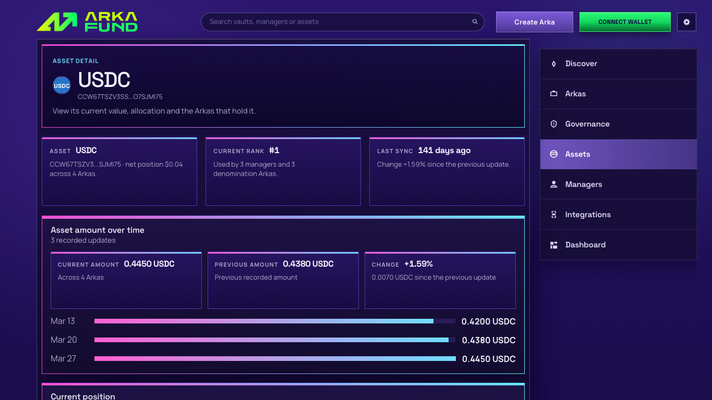

- Route: `/assets/CCW67TSZV3SSS2HXMBQ5JFGCKJNXKZM7UQUWUZPUTHXSTZLEO7SJMI75`
- Access: `public/read`
- Classification: public product
- Audience: Users inspecting one asset exposure.
- Visual source: Figma/reference family: `derived-assets`, reference `vaults screens(9).png`.

Purpose:

Show a selected asset's indexed exposure and linked Arkas.

Reads:
- asset detail catalog
- linked Arka context

Actions:
- open linked Arkas
- return to assets

Boundary:

Asset detail is read-only and catalog-backed.

Implementation:
- [src/components/product/AssetDetailSurface.tsx](../src/components/product/AssetDetailSurface.tsx)
- [src/app/assets/[id]/page.tsx](../src/app/assets/[id]/page.tsx)

Tests:
- [tests/integration/manager-asset-surfaces.test.tsx](../tests/integration/manager-asset-surfaces.test.tsx)
- [e2e/product-surfaces.spec.ts](../e2e/product-surfaces.spec.ts)

### 16. Asset profile - core registry fallback

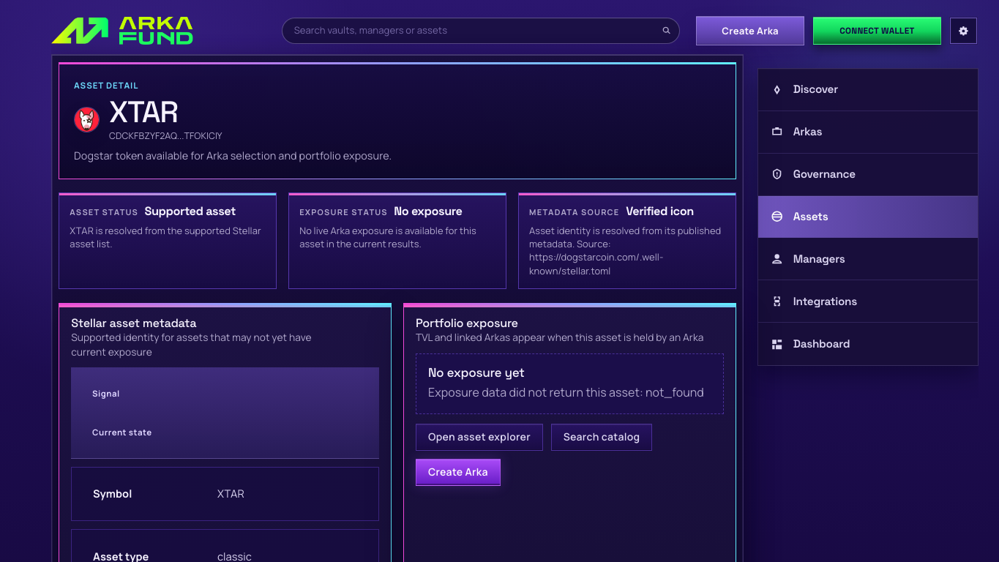

- Route: `/assets/CDCKFBZYF2AQCSM3JOF2ZM27O3Y6AJAI4OTCQKAFNZ3FHBYUTFOKICIY`
- Access: `public/read`
- Classification: public product
- Audience: Users inspecting a core Stellar asset.
- Visual source: Figma/reference family: `derived-assets`, reference `vaults screens(9).png`.

Purpose:

Show the registry-backed asset profile for known Stellar assets such as XLM, USDC, AQUA, XTAR and BLND.

Reads:
- core Stellar asset registry
- stellar.toml/CDN metadata fallback

Actions:
- open related Arkas where indexed

Boundary:

When a core asset is not indexed in current catalog data, the UI says so instead of fabricating exposure.

Implementation:
- [src/lib/catalog/coreStellarAssetRegistry.ts](../src/lib/catalog/coreStellarAssetRegistry.ts)
- [src/components/product/AssetDetailSurface.tsx](../src/components/product/AssetDetailSurface.tsx)

Tests:
- [tests/unit/core-stellar-asset-registry.test.ts](../tests/unit/core-stellar-asset-registry.test.ts)
- [tests/integration/api-assets-core-registry-route.test.ts](../tests/integration/api-assets-core-registry-route.test.ts)

### 17. Manager profile

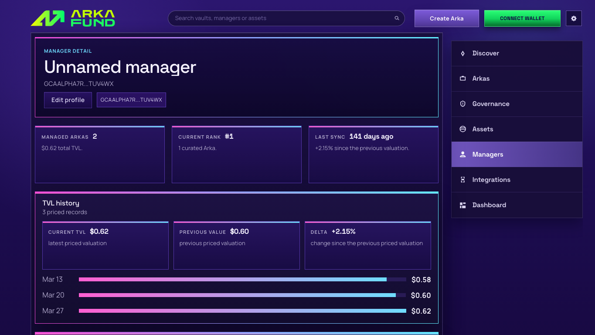

- Route: `/managers/GCAALPHA7RTH9KLMNOPQ2UVWX3YZ56789ABCDEFGHJKLMNPRSTUV4WX`
- Access: `public/read`
- Classification: public product
- Audience: Users evaluating one manager.
- Visual source: Figma/reference family: `derived-leaderboard`, reference `vaults screens(14).png`.

Purpose:

Show manager mandate, linked Arkas and catalog-backed track context.

Reads:
- manager detail catalog
- linked Arka set

Actions:
- open linked Arka profiles

Boundary:

Score/tier changes remain governed/operator actions outside this public profile.

Implementation:
- [src/components/product/ManagerDetailSurface.tsx](../src/components/product/ManagerDetailSurface.tsx)
- [src/app/managers/[id]/page.tsx](../src/app/managers/[id]/page.tsx)

Tests:
- [tests/integration/manager-asset-surfaces.test.tsx](../tests/integration/manager-asset-surfaces.test.tsx)
- [e2e/product-surfaces.spec.ts](../e2e/product-surfaces.spec.ts)

### 18. Vault ops index

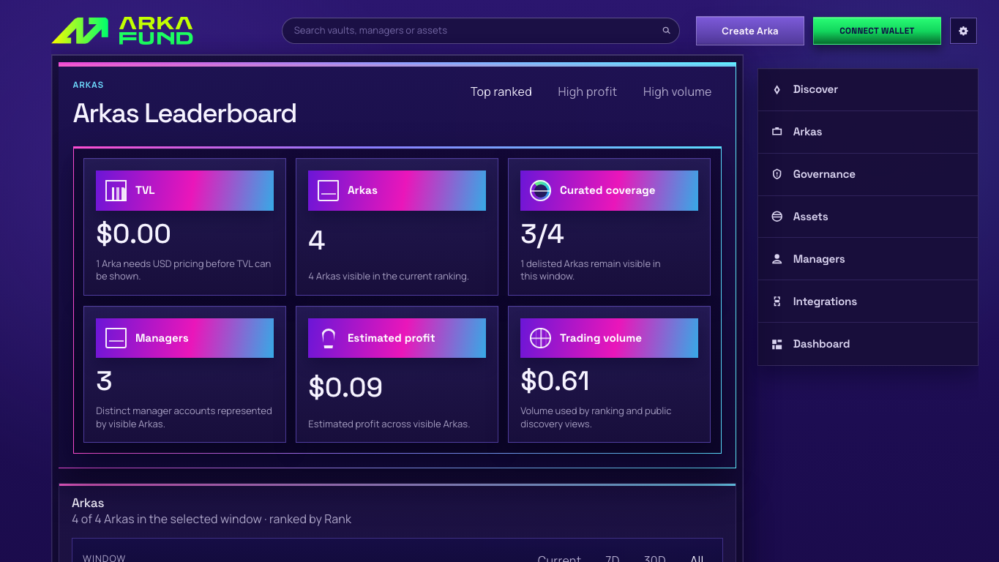

- Route: `/arkas`
- Access: `public/read`
- Classification: live execution launcher
- Audience: Users and managers moving from product browsing into live Arka operations.
- Visual source: Figma/reference family: `wallet-execution`, reference `vaults screens(6).png`.

Purpose:

Provide the operational entrypoint for known Arkas and clarify product-vs-execution route boundaries.

Reads:
- recent Arkas
- catalog/live route hints
- wallet state

Actions:
- open live Arka execution
- open Create Arka

Boundary:

This index launches execution but does not itself perform the write.

Implementation:
- [src/app/arkas/page.tsx](../src/app/arkas/page.tsx)
- [src/lib/workflows/arkaWorkspaces.ts](../src/lib/workflows/arkaWorkspaces.ts)

Tests:
- [tests/integration/vault-entrypoints.test.tsx](../tests/integration/vault-entrypoints.test.tsx)
- [e2e/vault-entrypoints.spec.ts](../e2e/vault-entrypoints.spec.ts)

### 19. Vault ops detail

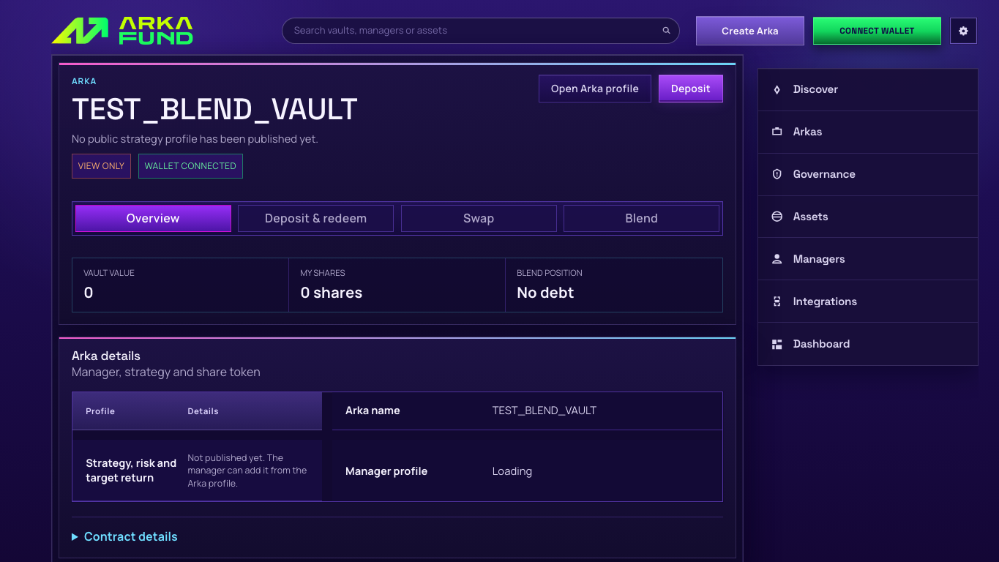

- Route: `/arkas/TEST_BLEND_VAULT`
- Access: `public/read`
- Classification: live execution
- Audience: Wallet users and authorized managers operating one Arka.
- Visual source: Figma/reference family: `wallet-execution`, reference `vaults screens(6).png`.

Purpose:

Deposit, redeem, rebalance and inspect credit/routing posture for one Arka.

Reads:
- Arka contract config
- wallet identity
- rebalance planner
- protocol adapters

Actions:
- deposit
- redeem
- rebalance
- run supported credit action

Boundary:

Writes require wallet flow, review and confirmation; protocol strategy is used here after creation.

Implementation:
- [src/app/arkas/[id]/page.tsx](../src/app/arkas/[id]/page.tsx)
- [src/lib/workflows/rebalanceRouting.ts](../src/lib/workflows/rebalanceRouting.ts)
- [src/lib/tx.ts](../src/lib/tx.ts)

Tests:
- [tests/integration/arka-detail-page.test.tsx](../tests/integration/arka-detail-page.test.tsx)
- [e2e/wallet-backed.spec.ts](../e2e/wallet-backed.spec.ts)
- [e2e/wallet-backed-matrix.spec.ts](../e2e/wallet-backed-matrix.spec.ts)

### 20. Governance

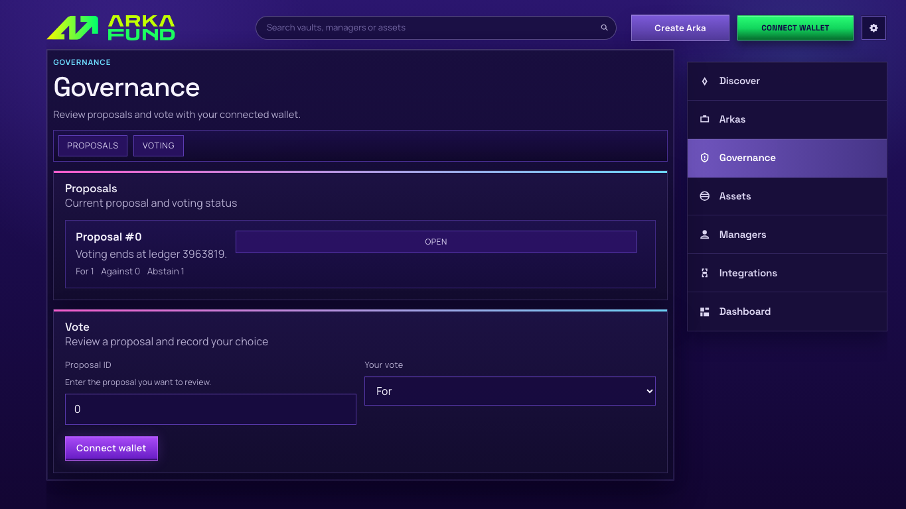

- Route: `/governance`
- Access: `public/read`
- Classification: DAO lifecycle
- Audience: Governance participants.
- Visual source: Derived surface: `derived-governance`, no direct Figma reference frame.

Purpose:

Run proposal lifecycle operations: propose, vote, close and execute.

Reads:
- governor config
- proposal state
- wallet vote posture

Actions:
- propose
- vote
- close
- execute

Boundary:

Governance-sensitive writes belong here or in the verified DAO console; they do not bypass timelock/executor controls.

Implementation:
- [src/app/governance/page.tsx](../src/app/governance/page.tsx)
- [src/lib/workflows/governanceLifecycle.ts](../src/lib/workflows/governanceLifecycle.ts)

Tests:
- [tests/unit/governance-lifecycle.test.ts](../tests/unit/governance-lifecycle.test.ts)
- [tests/integration/control-room-surfaces.test.tsx](../tests/integration/control-room-surfaces.test.tsx)

### 21. Coverage

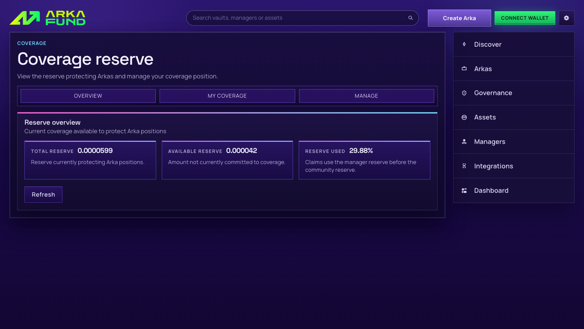

- Route: `/coverage`
- Access: `public/read`
- Classification: coverage fund
- Audience: Members and operators reviewing reserve posture.
- Visual source: Derived surface: `derived-coverage`, no direct Figma reference frame.

Purpose:

Operate first-loss/reserve coverage actions and member reward posture.

Reads:
- coverage reserve state
- member stake
- pending rewards

Actions:
- stake
- unstake
- claim rewards

Boundary:

Coverage fund mutations require wallet confirmation and typed amount validation.

Implementation:
- [src/app/coverage/page.tsx](../src/app/coverage/page.tsx)
- [src/lib/workflows/coverageWorkspaces.ts](../src/lib/workflows/coverageWorkspaces.ts)

Tests:
- [tests/unit/coverage-workspaces.test.ts](../tests/unit/coverage-workspaces.test.ts)
- [tests/integration/control-room-surfaces.test.tsx](../tests/integration/control-room-surfaces.test.tsx)

### 22. Operations control room

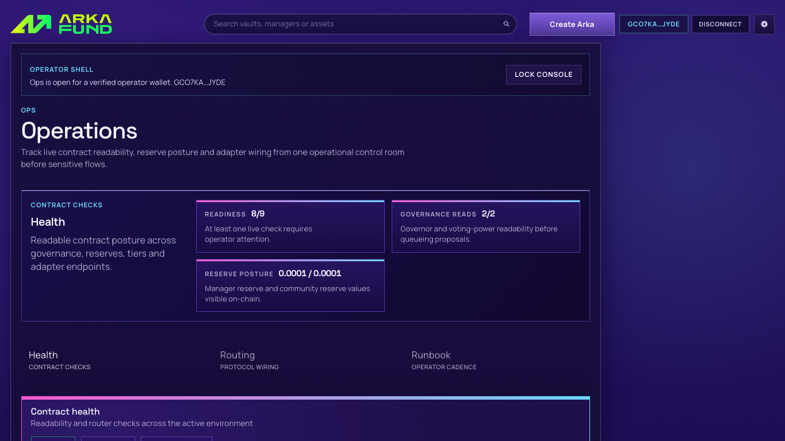

- Route: `/ops`
- Access: `verified operator`
- Classification: verified operator console
- Audience: Operators checking runbook readiness.
- Visual source: Figma/reference family: `operator-console`, reference `vaults screens(11).png`.

Purpose:

Show operational baselines, health checks and runbook status before risky actions.

Reads:
- operator workspace
- health endpoints
- runtime config

Actions:
- inspect health
- open relevant operator surfaces

Boundary:

Ops is diagnostic; it does not pretend to close testnet/mainnet evidence by itself.

Implementation:
- [src/app/ops/page.tsx](../src/app/ops/page.tsx)
- [src/lib/workflows/operatorWorkspaces.ts](../src/lib/workflows/operatorWorkspaces.ts)

Tests:
- [tests/unit/operator-workspaces.test.ts](../tests/unit/operator-workspaces.test.ts)
- [e2e/operator-surface-matrix.spec.ts](../e2e/operator-surface-matrix.spec.ts)

### 23. Contracts

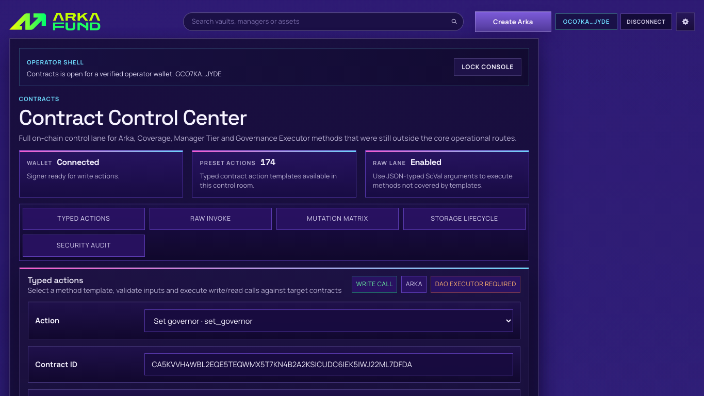

- Route: `/contracts`
- Access: `verified operator`
- Classification: verified operator console
- Audience: Operators performing low-level contract reads/writes under policy.
- Visual source: Derived surface: `operator-console`, no direct Figma reference frame.

Purpose:

Typed and raw contract interaction with mutation and storage matrices.

Reads:
- mutation matrix
- storage lifecycle
- contract wiring

Actions:
- typed read
- typed write
- raw read
- raw write
- inspect storage

Boundary:

DAO-governed writes are blocked or routed to governance; raw controls are not public product UI.

Implementation:
- [src/app/contracts/page.tsx](../src/app/contracts/page.tsx)
- [src/lib/contracts/mutationMatrix.ts](../src/lib/contracts/mutationMatrix.ts)
- [src/lib/contracts/storageLifecycle.ts](../src/lib/contracts/storageLifecycle.ts)

Tests:
- [tests/unit/contracts-mutation-matrix.test.ts](../tests/unit/contracts-mutation-matrix.test.ts)
- [tests/unit/contracts-storage-lifecycle.test.ts](../tests/unit/contracts-storage-lifecycle.test.ts)
- [tests/integration/contracts-page.test.tsx](../tests/integration/contracts-page.test.tsx)

### 24. Settings

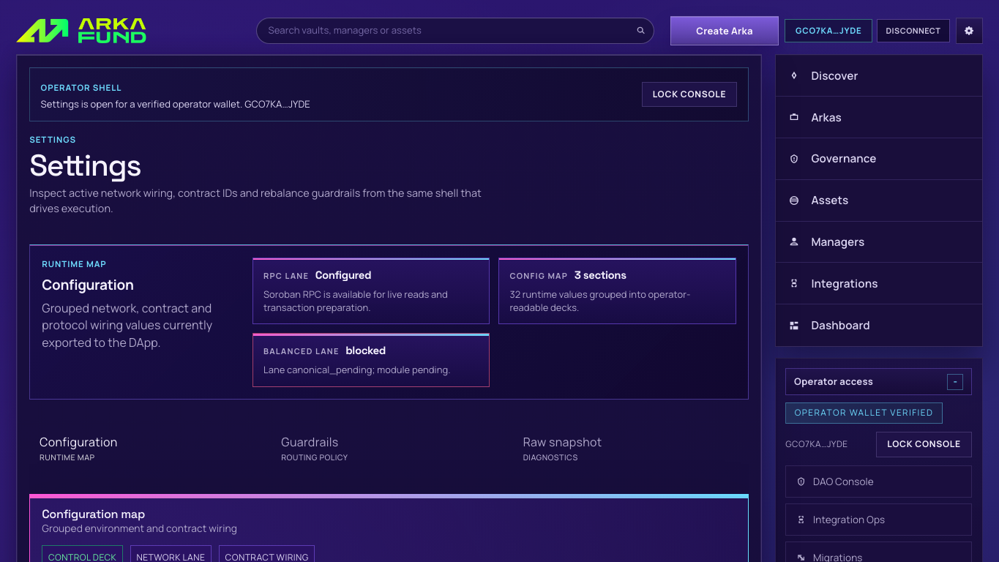

- Route: `/settings`
- Access: `verified operator`
- Classification: verified operator console
- Audience: Operators verifying environment and contract wiring.
- Visual source: Derived surface: `operator-console`, no direct Figma reference frame.

Purpose:

Inspect runtime config, contract IDs and guarded rebalance settings.

Reads:
- environment config
- contract map
- rebalance guardrail profile

Actions:
- inspect wiring
- copy/check config values

Boundary:

Settings is an inspection surface; changes to governed values require DAO flow.

Implementation:
- [src/app/settings/page.tsx](../src/app/settings/page.tsx)
- [src/lib/config.ts](../src/lib/config.ts)
- [src/lib/workflows/rebalanceGuardrailState.ts](../src/lib/workflows/rebalanceGuardrailState.ts)

Tests:
- [tests/unit/rebalance-guardrail-state.test.ts](../tests/unit/rebalance-guardrail-state.test.ts)
- [tests/integration/workflow-surfaces.test.tsx](../tests/integration/workflow-surfaces.test.tsx)

### 25. Status

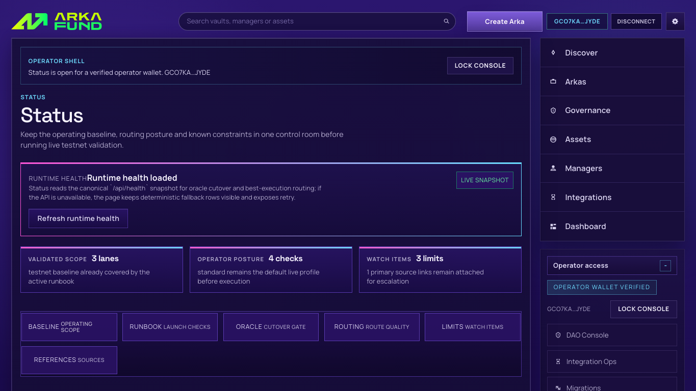

- Route: `/status`
- Access: `verified operator`
- Classification: verified operator console
- Audience: Operators validating release readiness.
- Visual source: Derived surface: `operator-console`, no direct Figma reference frame.

Purpose:

Show release blockers, oracle cutover posture, routing gate status and known limits.

Reads:
- oracle cutover gate
- routing canary gate
- production environment gate
- reference links

Actions:
- inspect blockers
- open reference docs

Boundary:

Status can report readiness but cannot create missing mainnet evidence.

Implementation:
- [src/app/status/page.tsx](../src/app/status/page.tsx)
- [src/lib/workflows/statusWorkspaces.ts](../src/lib/workflows/statusWorkspaces.ts)
- [src/lib/runtime/oracleCutoverGate.ts](../src/lib/runtime/oracleCutoverGate.ts)
- [src/lib/runtime/rebalanceCanaryGate.ts](../src/lib/runtime/rebalanceCanaryGate.ts)

Tests:
- [tests/unit/status-workspaces.test.ts](../tests/unit/status-workspaces.test.ts)
- [tests/unit/oracle-cutover-gate.test.ts](../tests/unit/oracle-cutover-gate.test.ts)
- [tests/unit/rebalance-canary-gate.test.ts](../tests/unit/rebalance-canary-gate.test.ts)

### 26. Manager tiers

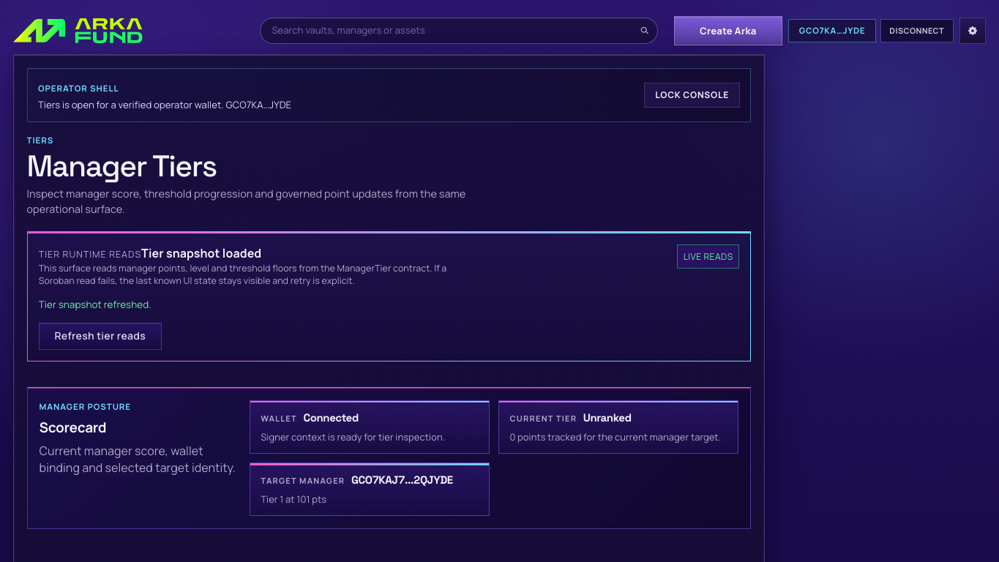

- Route: `/tiers`
- Access: `verified operator`
- Classification: verified operator console
- Audience: Operators and governance reviewers managing manager reputation posture.
- Visual source: Figma/reference family: `operator-console`, reference `vaults screens(8).png`.

Purpose:

Inspect and apply tier/points posture where authorization and governance policy allow it.

Reads:
- manager tier config
- scorecard data
- governance policy

Actions:
- review tier thresholds
- prepare governed tier/point changes

Boundary:

Manager reputation changes are governed/operator actions, not public leaderboard edits.

Implementation:
- [src/app/tiers/page.tsx](../src/app/tiers/page.tsx)
- [src/lib/workflows/controlSurfaces.ts](../src/lib/workflows/controlSurfaces.ts)
- [src/lib/workflows/daoExecutionPolicy.ts](../src/lib/workflows/daoExecutionPolicy.ts)

Tests:
- [tests/unit/control-surfaces.test.ts](../tests/unit/control-surfaces.test.ts)
- [tests/integration/control-room-surfaces.test.tsx](../tests/integration/control-room-surfaces.test.tsx)

### 27. Migrations

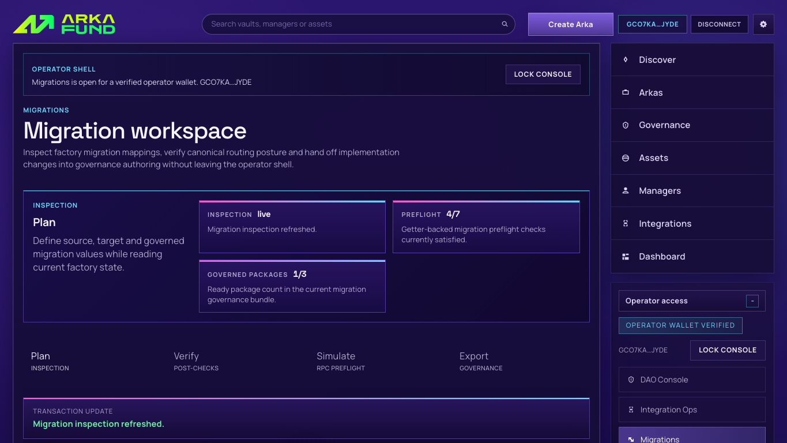

- Route: `/migrations`
- Access: `verified operator`
- Classification: verified operator console
- Audience: Operators preparing governed migrations.
- Visual source: Derived surface: `operator-console`, no direct Figma reference frame.

Purpose:

Inspect, simulate and prepare migration payloads before they are executed through approved governance/operator paths.

Reads:
- migration workspace
- migration inspect API
- simulation output

Actions:
- inspect migration
- simulate migration
- review payload

Boundary:

Migration payloads are previewed and validated; final mainnet migration remains a governed/cutover operation.

Implementation:
- [src/app/migrations/page.tsx](../src/app/migrations/page.tsx)
- [src/lib/workflows/migrationWorkspace.ts](../src/lib/workflows/migrationWorkspace.ts)
- [src/app/api/migrations/simulate/route.ts](../src/app/api/migrations/simulate/route.ts)

Tests:
- [tests/unit/migration-workspace.test.ts](../tests/unit/migration-workspace.test.ts)
- [tests/integration/migration-page.test.tsx](../tests/integration/migration-page.test.tsx)
- [tests/integration/api-migrations-simulate-route.test.ts](../tests/integration/api-migrations-simulate-route.test.ts)

### 28. DAO Console

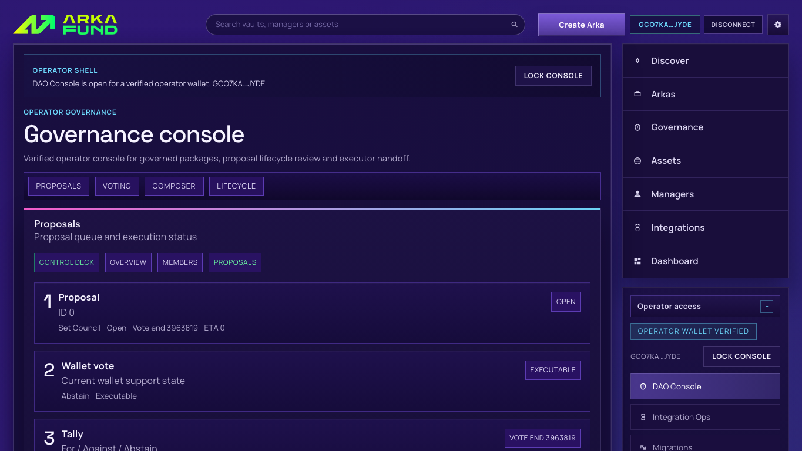

- Route: `/governance/console`
- Access: `verified operator`
- Classification: verified operator console
- Audience: Verified governance operators preparing executable DAO payloads.
- Visual source: Derived surface: `operator-console`, no direct Figma reference frame.

Purpose:

Compose and review governed action packages before proposal/execution lanes.

Reads:
- governance composer policy
- DAO execution policy
- operator session

Actions:
- select governed package
- validate arguments
- review execution effect

Boundary:

The console prepares validated packages; it does not fabricate a generic Governor batch primitive if the contract does not expose one.

Implementation:
- [src/app/governance/console/page.tsx](../src/app/governance/console/page.tsx)
- [src/lib/workflows/governanceComposer.ts](../src/lib/workflows/governanceComposer.ts)
- [src/lib/workflows/daoExecutionPolicy.ts](../src/lib/workflows/daoExecutionPolicy.ts)

Tests:
- [tests/unit/governance-composer.test.ts](../tests/unit/governance-composer.test.ts)
- [tests/unit/dao-execution-policy.test.ts](../tests/unit/dao-execution-policy.test.ts)
- [e2e/operator-surface-matrix.spec.ts](../e2e/operator-surface-matrix.spec.ts)

### 29. Integration Ops

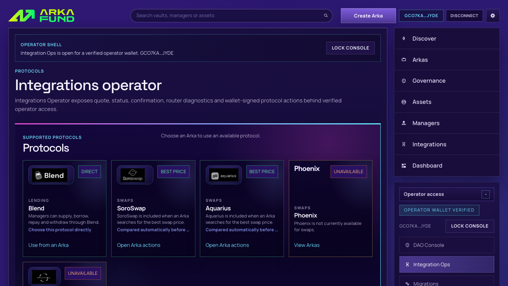

- Route: `/integrations/operator`
- Access: `verified operator`
- Classification: verified operator console
- Audience: Operators validating protocol execution lanes.
- Visual source: Derived surface: `operator-console`, no direct Figma reference frame.

Purpose:

Inspect adapter evidence, quote/status/confirm posture and operator-only integration controls.

Reads:
- integration workspace
- protocol evidence
- Balanced/SODAX status

Actions:
- inspect protocol readiness
- open execution evidence
- refresh integration status

Boundary:

Operator integration controls remain separate from public protocol overview and are wallet/operator-gated.

Implementation:
- [src/app/integrations/operator/page.tsx](../src/app/integrations/operator/page.tsx)
- [src/lib/workflows/integrationWorkspaces.ts](../src/lib/workflows/integrationWorkspaces.ts)
- [src/lib/workflows/intentVenueSources.ts](../src/lib/workflows/intentVenueSources.ts)

Tests:
- [tests/unit/integration-workspaces.test.ts](../tests/unit/integration-workspaces.test.ts)
- [tests/unit/intent-venue-sources.test.ts](../tests/unit/intent-venue-sources.test.ts)
- [e2e/operator-surface-matrix.spec.ts](../e2e/operator-surface-matrix.spec.ts)

## Verification Commands

- Generate screenshots: `npm run docs:screenshots`.
- Regenerate this manual: `npm run docs:platform-manual`.
- Verify manual, screenshot paths and implementation/test refs: `npm run docs:platform-manual:check`.
- Run the focused unit/integration evidence: `npx vitest run tests/unit/platform-manual-manifest.test.ts tests/integration/platform-manual-generator.test.ts`.
- Run the E2E screenshot capture: `npx playwright test e2e/design-audit.spec.ts --project=chromium --workers=1`.
