# Arka.fund dApp Visual Manual

Date: 2026-04-24  
Scope: current testnet/runtime frontend as implemented in the dApp repository

## 1. Why this manual exists

This document is the visual companion to the textual screen manual in [DAPP_SCREEN_MANUAL_2026-04-23.md](./DAPP_SCREEN_MANUAL_2026-04-23.md).

Its purpose is narrower and more practical:

- show the current rendered screen for every major route
- explain what each route is for
- explain what each route reads and what it can mutate
- make route boundaries explicit
- document which screens are product browsing surfaces and which are operational / governed surfaces
- keep the screenshots next to the explanation so design/product/engineering can review the same artifact

## 2. Frontend model at a glance

The dApp is intentionally split into three route families:

- Product rail:
  - `/dashboard`
  - `/discover`
  - `/vaults`
  - `/vaults/[id]`
  - `/managers`
  - `/managers/[id]`
  - `/assets`
  - `/assets/[id]`
- Live execution routes:
  - `/arkas`
  - `/arkas/[id]`
- Advanced Console:
  - `/factory/create`
  - `/governance`
  - `/coverage`
  - `/integrations`
  - `/ops`
  - `/contracts`
  - `/settings`
  - `/status`
  - `/tiers`

The distinction is deliberate:

- product rail routes are for discovery, ranking, context and portfolio review
- live execution routes are for wallet-backed execution against a concrete Arka
- Advanced Console routes are for deployment, DAO, policy, protocol integration, diagnostics and raw controls

## 3. DAO boundary and transactional UX model

The DAO problem is resolved by route and policy separation, not by leaving dangerous writes everywhere.

- governance-sensitive writes are intentionally not treated as normal direct wallet actions
- the rule lives in [daoExecutionPolicy.ts](../src/lib/workflows/daoExecutionPolicy.ts)
- `set_*` style governance mutations and the documented guarded mutation set are treated as DAO-gated
- typed writes outside the `GovernanceExecutor` lane are blocked when they are DAO-governed
- raw writes are also blocked unless they target the configured governance executor contract itself

In practice this means:

- `/governance` is the formal lifecycle surface for `propose -> vote -> close -> execute`
- `/contracts` is a powerful control center, but it does not bypass DAO policy
- when a write belongs to Governor + Executor flow, the UI explains that and routes the operator toward governance instead of pretending the mutation can be broadcast directly

The transactional UX language is now shared and design-coherent across the main write surfaces:

- `TransactionReviewCard`: explains what the action will touch before the user signs
- `TransactionConfirmDialog`: gives a proper confirmation checkpoint for writes, using the same visual language as the rest of the control room
- `TransactionFeedbackRail`: normalizes loading, success and error feedback without dropping into crude generic alerts
- `ActionField`: standardizes field label, hint, validation copy and spacing
- numeric and decimal inputs now use explicit `inputMode` on the critical flows so mobile/desktop data entry is less error-prone

This layer was applied to:

- `/factory/create`
- `/governance`
- `/coverage`
- `/integrations`
- `/arkas/[id]`
- `/contracts`

## 4. Product rail screens

### 4.1 `/dashboard` — Dashboard

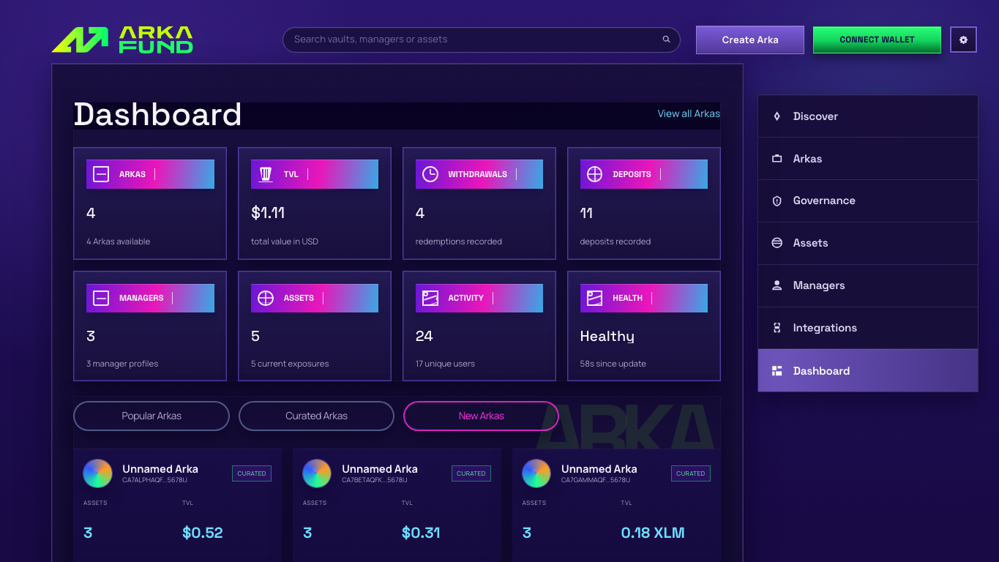

Purpose:

- show the overall indexed operating picture in one place
- answer "what is the current portfolio posture?" before the user drills down

What it reads:

- dashboard overview from the catalog layer
- ranked Arkas and managers
- top-line composition and monitoring signals

What it lets the user do:

- navigate into product exploration
- identify the sleeves, managers and Arkas worth opening next

Wallet dependency:

- none for reading

Important boundary:

- this is a summary surface, not a live execution lane

### 4.2 `/discover` — Discover

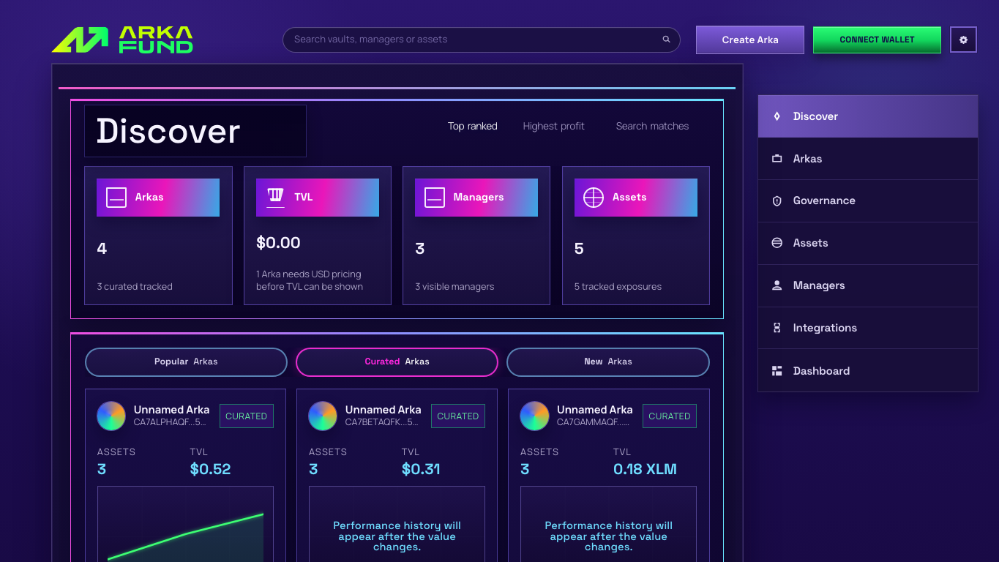

Purpose:

- search across the indexed product space
- pivot between Arkas, managers and assets from one place

What it reads:

- catalog-backed search results for Arkas
- managers
- assets

What it lets the user do:

- filter and screen the indexed universe
- jump into the relevant detail route

Wallet dependency:

- none for reading

Important boundary:

- no signing happens here; this is discovery and screening only

### 4.3 `/vaults` — Arkas leaderboard

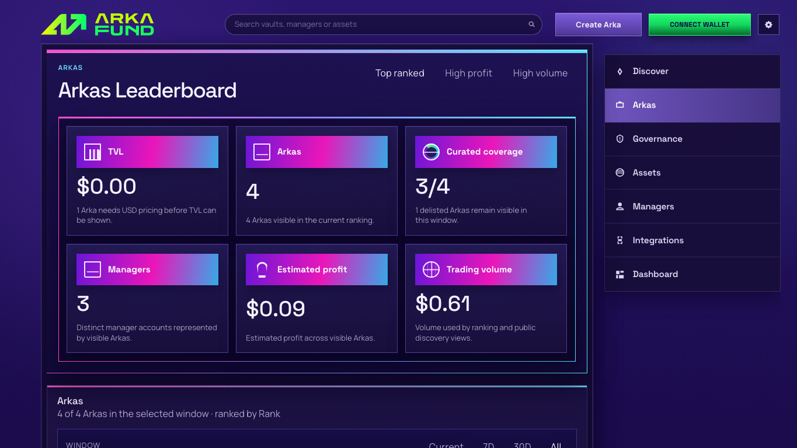

Purpose:

- rank and compare Arkas in a product-safe browsing surface

What it reads:

- leaderboard/catalog data for ranked Arkas
- managed NAV
- asset counts
- fees
- route posture and curated status

What it lets the user do:

- sort by rank and other surfaced metrics
- compare Arkas without entering the live execution lane
- move into the detailed indexed profile

Wallet dependency:

- none for browsing

Important boundary:

- `/vaults` is review mode, not a transaction route

### 4.4 `/vaults/[id]` — Arka profile

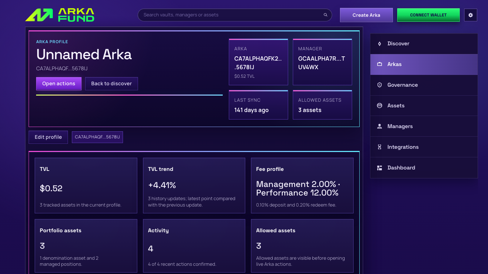

Purpose:

- present a detailed indexed profile of one Arka before the user enters live operations

What it reads:

- Arka catalog profile
- performance and composition context
- manager metadata
- route and strategy posture

What it lets the user do:

- understand the Arka in product mode
- decide whether to open live execution

Wallet dependency:

- none for reading

Important boundary:

- this is still profile/review mode; live deposit/redeem/rebalance lives under `/arkas/[id]`

### 4.5 `/managers` — Managers leaderboard

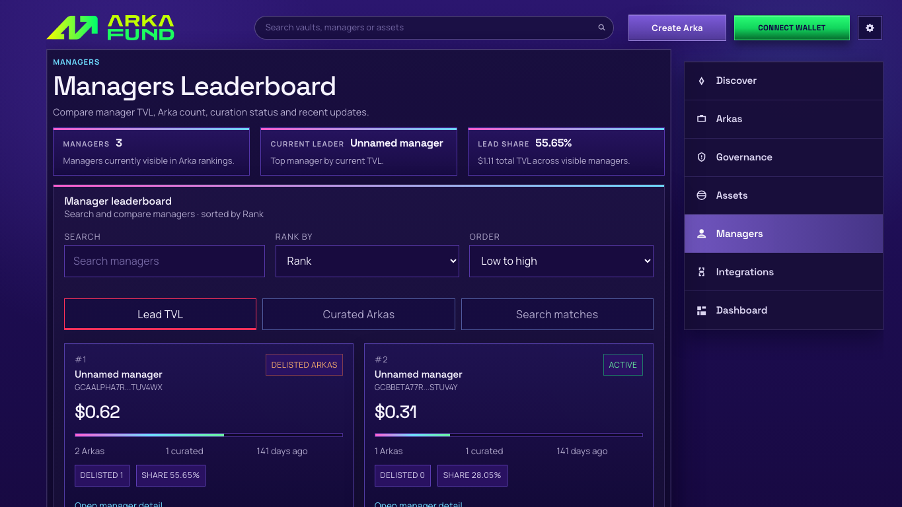

Purpose:

- rank managers and expose mandate/reputation context

What it reads:

- manager leaderboard/catalog data
- manager score, track record and managed footprint

What it lets the user do:

- compare managers
- open manager detail
- use manager context as part of Arka selection

Wallet dependency:

- none for reading

Important boundary:

- this is a browsing surface, not the governance or manager mutation lane

### 4.6 `/managers/[id]` — Manager detail

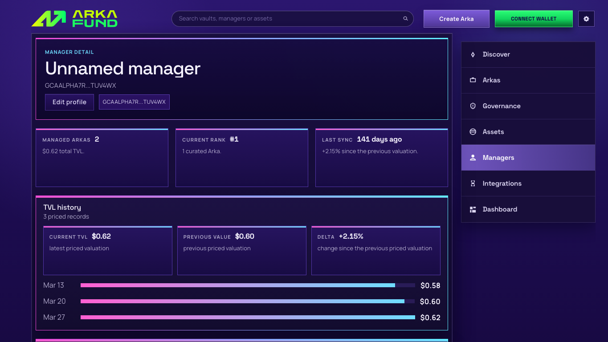

Purpose:

- show the story of one manager: mandate, managed set, operating posture and reputation context

What it reads:

- manager profile
- linked Arkas
- mandate/risk context
- score/tier related context if available from runtime surfaces

What it lets the user do:

- inspect a manager more deeply before choosing an Arka

Wallet dependency:

- none for reading

### 4.7 `/assets` — Assets

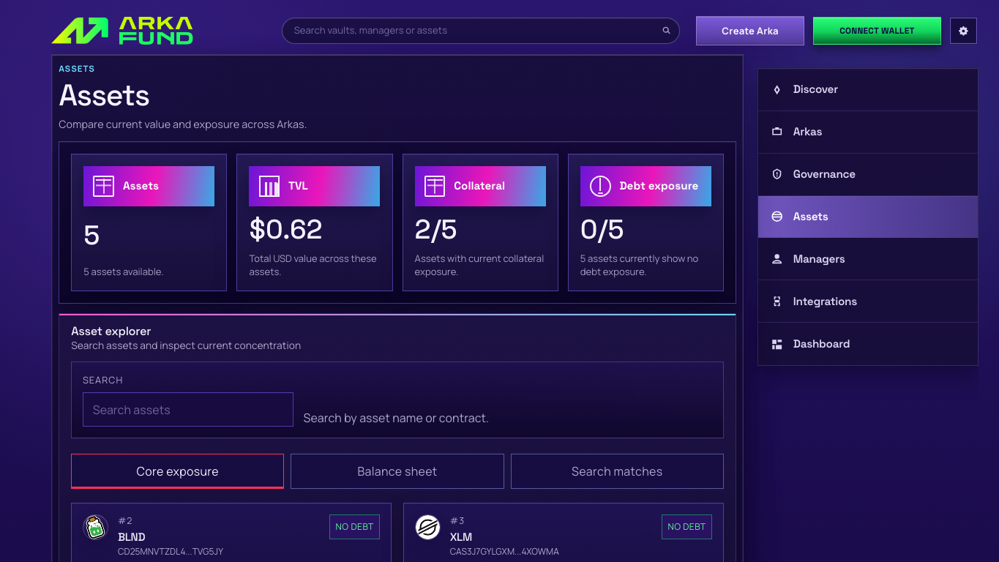

Purpose:

- browse asset-level concentration and exposure

What it reads:

- asset catalog
- exposure concentrations
- linked Arkas
- ranking and search context

What it lets the user do:

- inspect the asset set behind the indexed product universe
- jump into asset detail

Wallet dependency:

- none for reading

### 4.8 `/assets/[id]` — Asset detail

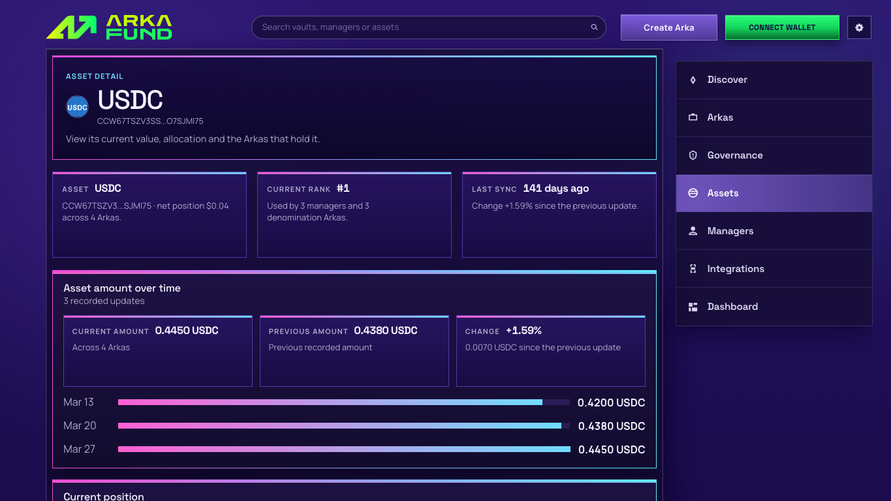

Purpose:

- explain a single asset's role inside the indexed universe

What it reads:

- asset profile data
- linked Arkas / exposure footprint
- concentration and relevance posture

What it lets the user do:

- understand asset concentration before using an Arka or manager route

Wallet dependency:

- none for reading

## 5. Live execution routes

### 5.1 `/arkas` — Live vault ops index

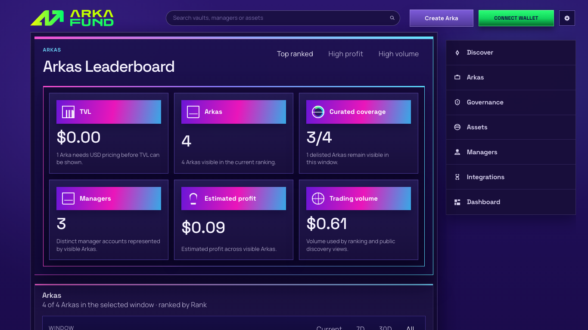

Purpose:

- provide the operational entrypoint into live Arka execution
- make the difference between product review and execution explicit

What it reads:

- available live Arka shortcuts
- route boundaries
- featured watchlists

What it lets the user do:

- jump into a concrete live execution route
- move into create/deployment when the user wants to instantiate a new Arka

Wallet dependency:

- browsing does not require wallet
- entering write flows later will

Important boundary:

- `/arkas` is an operational launcher, not the transaction screen itself

### 5.2 `/arkas/[id]` — Live vault execution

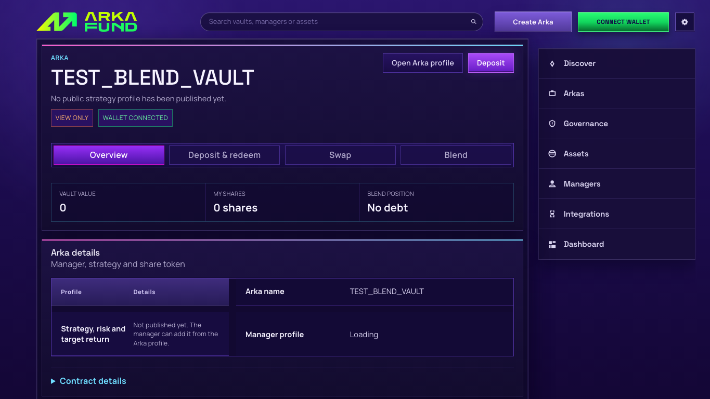

Purpose:

- central wallet-backed execution surface for a specific Arka

What it reads:

- Arka state
- denomination and balances
- rebalance planner posture
- protocol/credit posture

What it lets the user do:

- deposit
- redeem
- redeem all
- rebalance through supported execution lanes
- run credit actions in the currently supported credit market lane

Wallet dependency:

- required for write actions

Operational notes:

- deposit/redeem is user-facing capital movement
- rebalance is manager-sensitive execution
- protocol-specific controls still live in the same visual system to avoid fragmenting execution context
- transaction review cards, confirm dialog and feedback rails are intentionally part of this route now

## 6. Advanced Console screens

### 6.1 `/factory/create` — Create Arka

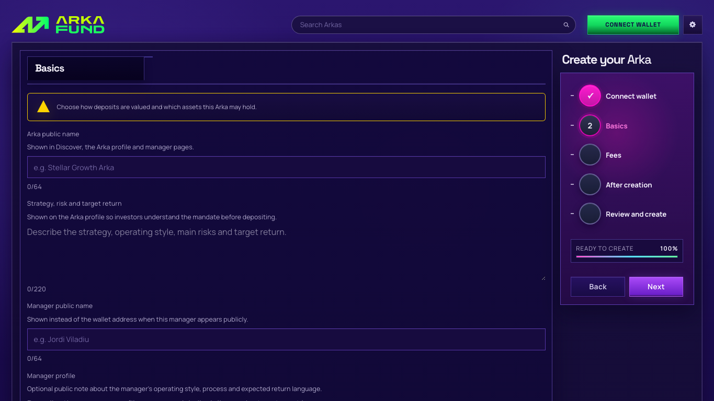

Purpose:

- guided deployment surface for creating a new Arka through `ArkaFactory`

What it reads:

- runtime configuration
- denomination options / defaults
- whitelist and fee inputs

What it lets the user do:

- prepare initial deployment parameters
- submit a create flow
- review the deployment payload before signing

Wallet dependency:

- required for the actual create transaction

Important boundary:

- creation is not a product browsing action; it is an operational deployment route

### 6.2 `/governance` — Governance

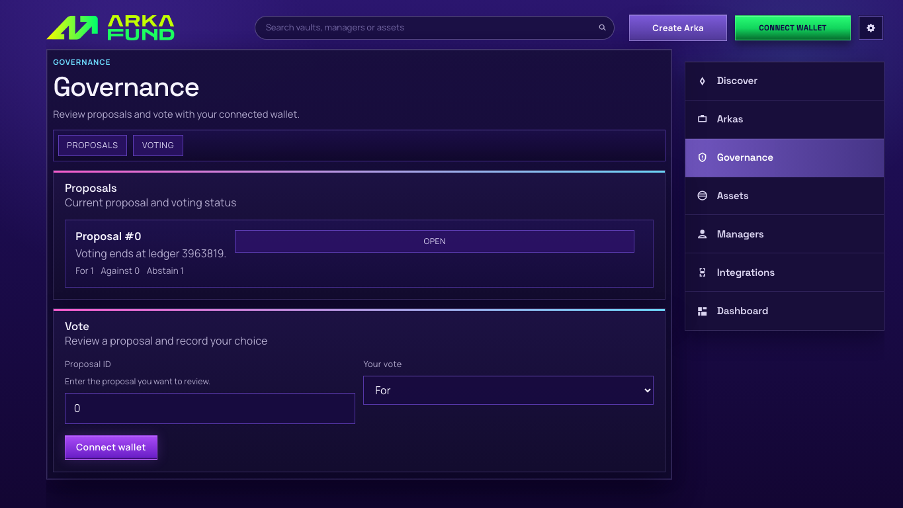

Purpose:

- the formal DAO lifecycle surface

What it reads:

- governor configuration
- proposal telemetry
- tally state
- wallet vote posture
- execution readiness

What it lets the user do:

- propose
- vote
- close
- execute

Wallet dependency:

- required for lifecycle actions

DAO resolution:

- this is the canonical surface for Governor + Executor flow
- governance-sensitive writes are intentionally explained and confirmed here instead of being treated as ordinary arbitrary contract writes

### 6.3 `/coverage` — Coverage

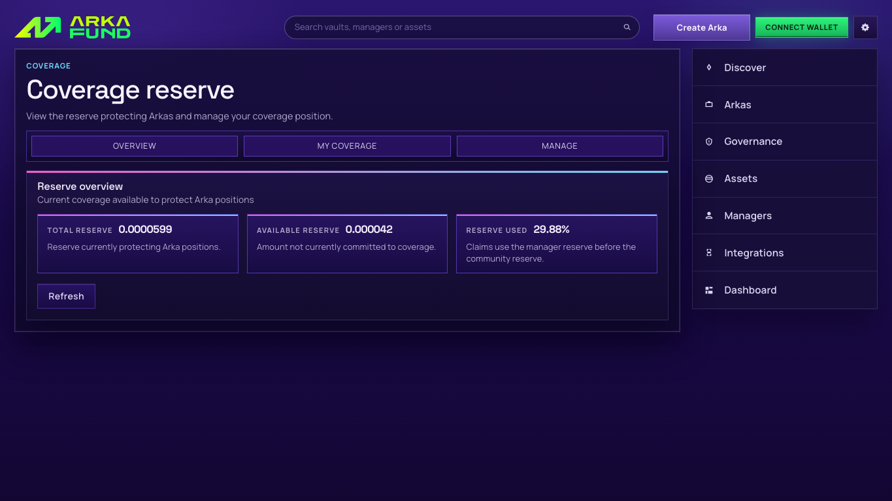

Purpose:

- operate the reserve / member coverage side of the platform

What it reads:

- reserve posture
- member lane posture
- withdrawable headroom
- wallet stake and pending rewards

What it lets the user do:

- stake
- unstake
- claim rewards

Wallet dependency:

- required for all fund mutations

Operational notes:

- the screen is split between posture reading and actual fund actions
- review cards and typed fields are now part of the fund actions lane

### 6.4 `/integrations` — Integrations

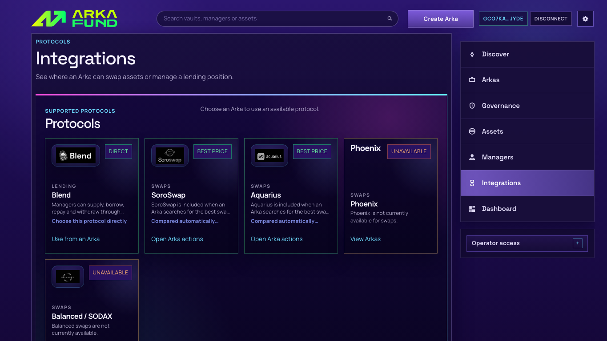

Purpose:

- map supported protocol surfaces and their current operational posture

What it reads:

- adapters and routers
- lane readiness
- Balanced/SODAX public surface posture
- protocol-specific status for Aquarius, SoroSwap and Blend

What it lets the user do:

- inspect protocol health
- request quotes/status where surfaced
- execute through admitted protocol lanes

Wallet dependency:

- required for direct execution buttons

Important boundary:

- this is the operator/protocol surface, not the primary product rail

### 6.5 `/ops` — Operations

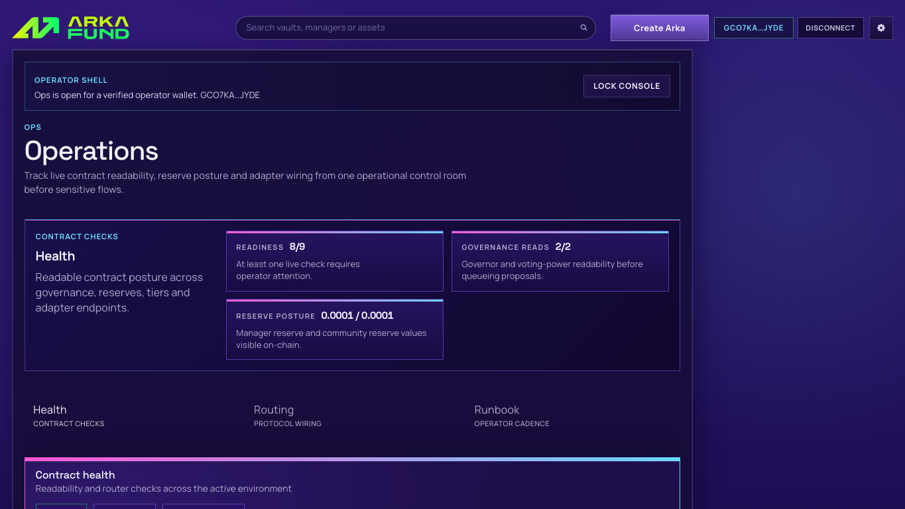

Purpose:

- operator runbook and health-check surface

What it reads:

- readiness checks
- operational posture
- environment and route readiness summaries

What it lets the user do:

- inspect the current operational baseline
- verify the platform before using higher-risk write surfaces

Wallet dependency:

- not typically required for the core checks

### 6.6 `/contracts` — Contract control center

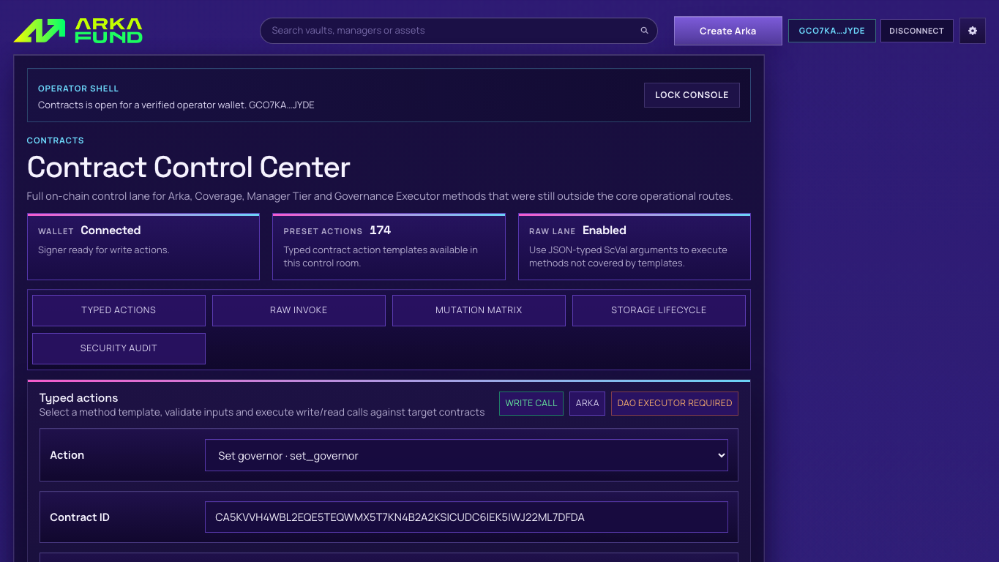

Purpose:

- the lowest-level on-chain control surface in the frontend

What it reads:

- typed action templates
- raw invoke lane input
- mutation matrix
- storage lifecycle matrix

What it lets the user do:

- execute typed reads
- execute typed writes
- execute raw reads
- execute raw writes
- inspect machine-consumable mutation and storage matrices

Wallet dependency:

- required for writes

DAO resolution:

- this route does not bypass governance policy
- DAO-guarded writes are blocked here unless they target the governance executor lane appropriately
- the UI explicitly tells the operator when a write belongs in `/governance`

Operational notes:

- because this is the sharpest tool in the frontend, it now uses the full transactional UX layer:
  - review cards
  - confirm dialog
  - standardized feedback rail
  - typed field hints

### 6.7 `/settings` — Settings

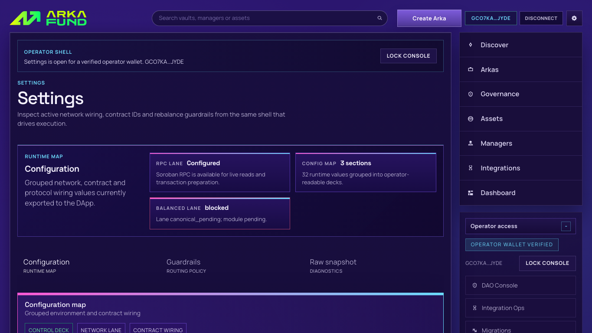

Purpose:

- configuration and contract-wiring inspection surface

What it reads:

- network configuration
- contract IDs
- router/adapter IDs
- rebalance guardrail settings
- raw environment snapshot

What it lets the user do:

- inspect how the current runtime is wired
- verify that config and policy values are what the operator expects

Wallet dependency:

- none for reading

### 6.8 `/status` — Status

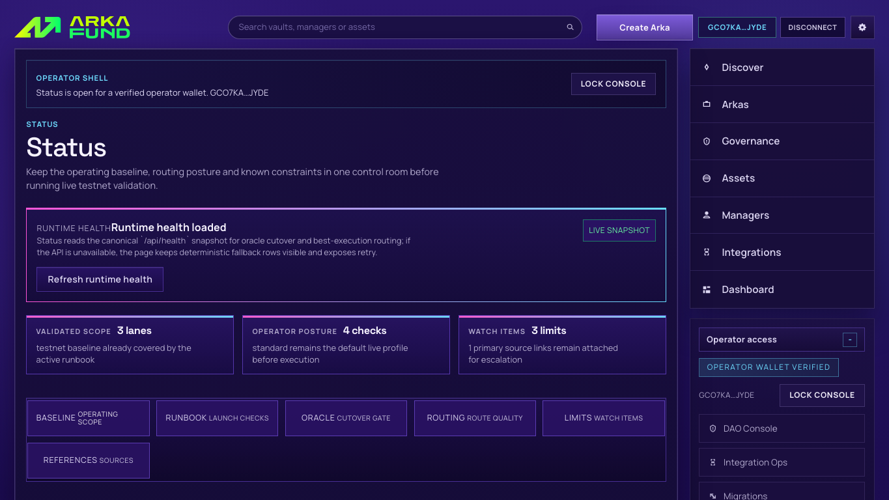

Purpose:

- readiness and release posture surface

What it reads:

- baseline scope
- operator checklist
- known limits
- oracle cutover posture
- routing solver posture
- reference links

What it lets the user do:

- assess whether the current environment is ready, blocked or partially validated

Wallet dependency:

- none for reading

Important boundary:

- this is a runbook/status surface, not a mutation surface

### 6.9 `/tiers` — Manager tiers

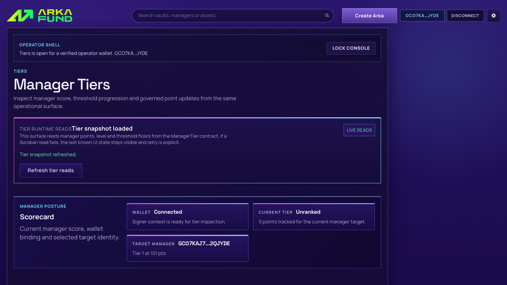

Purpose:

- reputation / score / tier control surface for managers

What it reads:

- points
- tier thresholds
- governor context
- scorecard posture

What it lets the user do:

- review tier logic
- apply governed point/tier mutations where the runtime/user is authorized

Wallet dependency:

- required for writes

## 7. Common UX patterns across screens

### 7.1 Read-first product surfaces

These screens are optimized for reading, filtering, comparing and ranking:

- `/dashboard`
- `/discover`
- `/vaults`
- `/vaults/[id]`
- `/managers`
- `/managers/[id]`
- `/assets`
- `/assets/[id]`

Expected characteristics:

- no signing requirement for normal reading
- search, sorting and stage navigation
- catalog-backed state instead of transaction state

### 7.2 Transactional surfaces

These routes are expected to expose mutation controls:

- `/arkas/[id]`
- `/factory/create`
- `/governance`
- `/coverage`
- `/integrations`
- `/contracts`
- `/tiers`

Shared interaction expectations:

- wallet gating before writes
- typed fields with hints and format guidance
- review card before action
- confirm dialog before write
- feedback rail after action

### 7.3 Diagnostic/control-room surfaces

These routes are about readiness and operator understanding:

- `/ops`
- `/settings`
- `/status`

Expected characteristics:

- high information density
- little or no user signing
- explicit environment / dependency context

## 8. What this visual manual does not claim

This document does not claim:

- that every route is pixel-perfect versus every historical Figma frame
- that every control is already backed by exhaustive E2E
- that every visible surface belongs in the eventual public release unchanged

What it does provide is:

- the current real route inventory
- the current real screenshots
- the current real role of each route
- the current route boundaries, especially around governance and low-level control

## 9. Related documents

- [DAPP_SCREEN_MANUAL_2026-04-23.md](./DAPP_SCREEN_MANUAL_2026-04-23.md)
- [E2E_AUDIT_MATRIX_2026-04-24.md](./E2E_AUDIT_MATRIX_2026-04-24.md)
- [DAPP_GUIDE.md](./DAPP_GUIDE.md)
